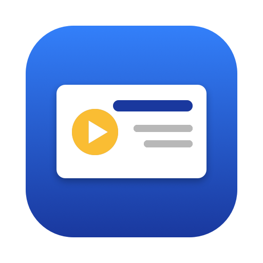

<div dir="rtl">

<p align="center"></p>

<h1 align="center">שקף</h1>

<p align="center"><b>אפליקציית מק לעריכה ולהצגה של מצגות, בעברית מלאה מימין לשמאל.</b><br>
חינם, בלי אינטרנט, בלי חשבון. קוד פתוח, רישיון MIT.</p>

---

## מה זה

שקף היא אפליקציה מקורית ל-macOS (Swift + SwiftUI, עם WKWebView לציור השקפים) לעריכה ולהצגה של מצגות. פותחים בה מצגת קיימת או מתחילים מאפס, עורכים, ומציגים במסך מלא.

> **כרגע האפליקציה היא ל-Mac בלבד.** גרסה ל-Windows מתוכננת בהמשך.

## למה עוד עורך מצגות

מי שמכין מצגות בעברית מכיר את הבעיות בעורכים הקיימים:

- **תשלום.** העורכים המובילים דורשים מנוי חודשי או שנתי, או נועלים חלק מהיכולות מאחורי תוכנית בתשלום.
- **אינטרנט וחשבון.** עורכים שרצים בדפדפן לא שמישים בלי חיבור, ודורשים הרשמה והתחברות לפני שאפשר להתחיל.
- **המצגת לא אצלך.** הקבצים נשמרים בענן של חברה אחרת, ולא תמיד ברור מי רואה אותם ומה קורה איתם.
- **עברית כמחשבה שנייה.** ממשק שמתורגם חלקית, טקסט מימין לשמאל שמתהפך, סימני פיסוק שקופצים לצד הלא נכון.
- **הקראה מסובכת.** כדי שכפתור ישמיע טקסט צריך להגדיר אובייקט שמע, טריגר ופעולה, וגם אז זה לא תמיד מתנהג אותו דבר בכל מחשב.
- **כובד.** תוכנות גדולות ואיטיות, מלאות ביכולות שרוב האנשים לא צריכים.

## מה שקף עושה אחרת

- **חינם, לתמיד.** אין מנוי, אין גרסת פרימיום, אין פרסומות.
- **מקומי לגמרי.** עריכה, הצגה, הקראה וייצוא עובדים בלי אינטרנט. אין חשבון ואין התחברות.
- **הקבצים שלך.** כל מצגת נשמרת במחשב שלך, בתיקייה רגילה שאפשר להעתיק ולגבות.
- **עברית קודם.** הממשק והשקפים בנויים מימין לשמאל מההתחלה.
- **הקראה בלחיצה.** מסמנים "כפתור הקראה" על תיבת טקסט וזהו. אם צירפת קובץ שמע הוא מתנגן, ואם לא, המק מקריא בקול עברי.
- **קוד פתוח.** אפשר לקרוא את הקוד, לשנות אותו ולבנות גרסה משלך.

## השוואה לעורכים אחרים

| | שקף | PowerPoint | Google Slides | Canva | Keynote |
|---|---|---|---|---|---|
| **מחיר** | חינם | בתשלום (מנוי או רכישה). גרסת הדפדפן חינמית | חינם לשימוש אישי | חינם עם מגבלות, והשאר במנוי | חינם למשתמשי Apple |
| **עבודה בלי אינטרנט** | כן, תמיד | כן באפליקציה. גרסת הדפדפן דורשת חיבור | רק אחרי הפעלה מראש של מצב לא מקוון, בדפדפן Chrome או Edge | רק אחרי הגדרה מראש באפליקציה, עם יכולות חלקיות | כן |
| **חשבון והתחברות** | לא צריך | צריך חשבון Microsoft להפעלה | צריך חשבון Google | צריך חשבון Canva | לא צריך |
| **איפה הקבצים** | במחשב שלך | במחשב או ב-OneDrive | ב-Google Drive | בענן של Canva | במחשב או ב-iCloud |
| **ממשק בעברית מימין לשמאל** | כן, מההתחלה | כן | כן | כן | כן |
| **כפתור הקראה לטקסט** | מובנה, בלחיצה אחת | הגדרה ידנית של שמע ופעולה | הגדרה ידנית של קובץ שמע | הגדרה ידנית של קובץ שמע | הגדרה ידנית של שמע ופעולה |
| **הקראה בקול עברי בלי קובץ שמע** | כן, בלי אינטרנט | לא בזמן הצגה | לא | לא | לא |
| **קוד פתוח** | כן (MIT) | לא | לא | לא | לא |
| **מערכות הפעלה** | Mac (בהמשך Windows) | Windows, Mac, דפדפן | דפדפן | דפדפן ואפליקציות | Mac, iPhone, iPad |

ההשוואה נכונה למועד הכתיבה (נובמבר 2026) ולפי מה שהחברות מפרסמות. תנאים ומחירים משתנים, אז כדאי לבדוק באתר של כל מוצר.

בהגינות: העורכים האחרים ותיקים ועשירים הרבה יותר. יש בהם תבניות, עבודה משותפת בזמן אמת, טבלאות, תרשימים ווידאו, ואלה עדיין לא קיימים בשקף. שקף מתאים למי שרוצה כלי פשוט, מקומי וחינמי, עם עברית והקראה שעובדות בלי התעסקות.

החריג היחיד לעבודה בלי אינטרנט: ייבוא של דף HTML שמפנה בעצמו לתמונות או לגופנים באינטרנט.

## מה היא יודעת לעשות

**ייבוא**
- PowerPoint ‏(`pptx`), כולל מעברים, אנימציות כניסה, לולאות תנועה וסאונד
- LibreOffice Impress ‏(`odp`)
- PDF (כל עמוד הופך לשקף)
- HTML (מפרק את הדף לטקסטים, תמונות וצורות שאפשר לערוך)
- Keynote ‏(`key`) ו-PowerPoint ישן (`ppt`), דרך Keynote או PowerPoint שמותקנים במק
- תמונות (כל תמונה הופכת לשקף)
- גוררים קובץ לחלון, או בוחרים "פתח קובץ"

**עריכה**
- רשימת שקפים בצד: הוספה, מחיקה, שכפול וסידור בגרירה
- תיבות טקסט, תמונות וצורות
- הזזה, שינוי גודל וסיבוב בעכבר, עם קווי יישור
- גופנים, צבעים, קו מתאר, פינות מעוגלות, צל ושקיפות
- ביטול וחזרה, העתקה והדבקה
- שמירה אוטומטית, וגם כפתור "שמור"

**הצגה**
- מסך מלא
- מעברים בין שקפים: עמעום, דחיפה, זום ומורף
- אנימציות כניסה בלחיצה
- סאונד למעבר ולכניסת אלמנט
- קובץ שמע לשקף

**הקראה**
- על כל תיבת טקסט אפשר לשים כפתור "הקראה"
- אם צורף קובץ שמע, הוא מתנגן
- אם לא, הטקסט מוקרא בקול העברי של המק (כרמית), בלי אינטרנט

**ייצוא**
- `pptx`, עם טקסט שאפשר לערוך ב-PowerPoint
- `pdf`
- `html`, קובץ אחד שנפתח בכל דפדפן ומציג את המצגת עם המעברים

## התקנה

דרישות: macOS 14 ומעלה, וכלי הפיתוח של אפל (`xcode-select --install`).

```bash
git clone https://github.com/shmuelr16/shekef.git
cd shekef
./build.sh install
```

הסקריפט בונה את האפליקציה (ל-Intel ול-Apple Silicon), מתקין אותה ב-`/Applications/שקף.app`, ומשם פותחים אותה בלחיצה כפולה כמו כל אפליקציה.

בלי הפרמטר `install` הסקריפט רק בונה, והתוצאה נמצאת ב-`build/שקף.app`.

האפליקציה חתומה בחתימה מקומית בלבד (לא דרך Apple). כשבונים אותה במחשב שלך היא נפתחת רגיל. אם מעתיקים אותה ממחשב אחר, צריך בפעם הראשונה ללחוץ עליה בכפתור ימני ולבחור "פתח".

## איפה נשמרות המצגות

מצגות חדשות ומצגות מיובאות נשמרות ב-`~/Documents/שקף`. כל מצגת היא חבילה עם הסיומת `.shekef`, ובתוכה קובץ `deck.json` ותיקיית `media` עם התמונות והשמע.

## מגבלות ידועות

- אין תמיכה בסרטוני וידאו בתוך שקף.
- בייצוא ל-`pptx` כל אנימציות הכניסה הופכות לעמעום, ולולאות תנועה וכפתורי הקראה לא עוברות כפעולות.
- בייבוא `pptx` לא מיובאים טבלאות ותרשימים.
- ייבוא `key` ו-`ppt` דורש Keynote או PowerPoint מותקן, ומבקש הרשאה בפעם הראשונה.
- ייבוא HTML הוא בקירוב: עיצוב מורכב עלול להשתנות.
- הייבוא של `odp`, `key`, `ppt` ו-`html` נבדק פחות מהייבוא של `pptx`. אם משהו נשבר, נשמח לדיווח.

## מבנה הקוד

| תיקייה | מה יש בה |
|---|---|
| `Sources/Shekef` | קוד ה-Swift: מודל, מצב האפליקציה, ממשק SwiftUI, ייבוא, ייצוא, שמע |
| `Web` | שכבת השקפים שרצה ב-WKWebView: ציור, עורך, נגן |
| `Sounds` | אפקטי הסאונד המובנים |
| `build.sh` | בנייה והתקנה |

פירוט נוסף למפתחים נמצא ב-[CLAUDE.md](CLAUDE.md).

## קוד פתוח

הפרויקט פתוח תחת [רישיון MIT](LICENSE). מותר להשתמש, לשנות ולהפיץ. דיווחי באגים והצעות לשיפור מתקבלים בברכה דרך Issues ו-Pull Requests.

## מה בהמשך

- גרסה ל-Windows
- וידאו בתוך שקף
- ייצוא מלא יותר של אנימציות ל-PowerPoint

---

<p align="center">הוכן ע״י שמואל</p>

</div>

---

## English summary

**Shekef** ("slide" in Hebrew) is a native macOS app for editing and presenting slide decks, with full right-to-left Hebrew support. It is free, works fully offline, and needs no account or subscription. It imports `pptx`, `odp`, `pdf`, `html`, `key`, `ppt` and images, exports `pptx`, `pdf` and `html`, and has a read-aloud button that plays an attached audio file or falls back to the Mac's offline Hebrew voice.

**macOS only for now. A Windows version is planned.** Open source under the MIT license.

Install: `git clone https://github.com/shmuelr16/shekef.git && cd shekef && ./build.sh install` (requires macOS 14+ and the Xcode command line tools).
